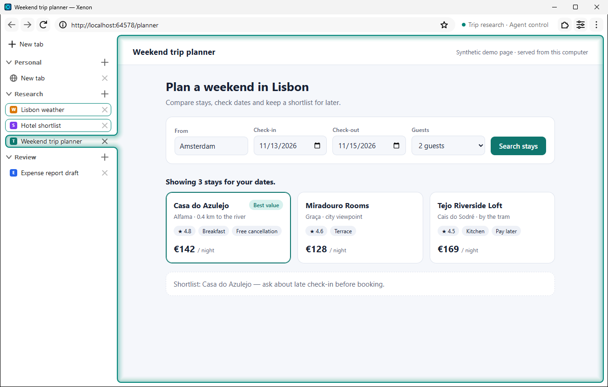
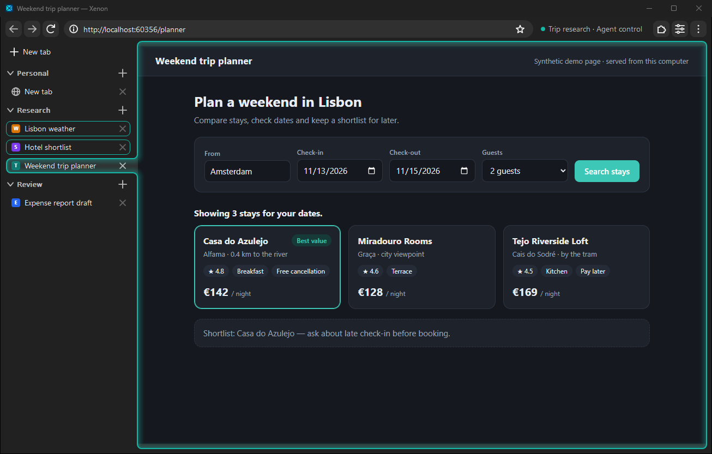
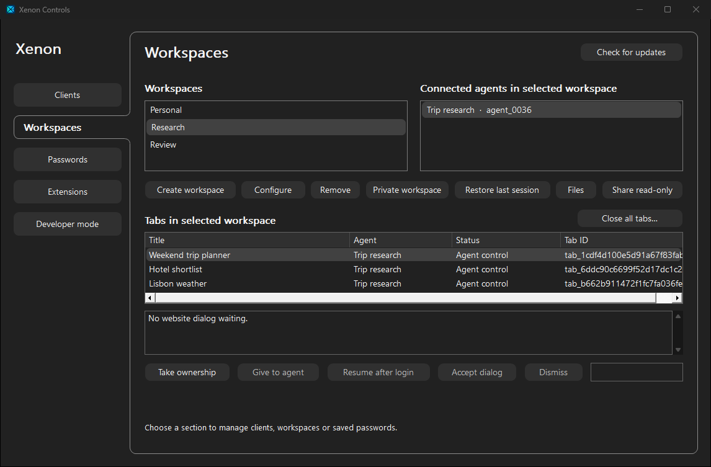

<div align="center">


# Xenon Browser

**The Windows browser you share with your AI agents.**

Everyday Chromium browsing for you, a native control layer for MCP agents,<br>and you decide what each agent can reach.

[](https://github.com/Xero-05/xenon-browser/releases/latest)
[](https://github.com/Xero-05/xenon-browser/actions/workflows/windows.yml)
[](docs/GETTING_STARTED.md)
[](docs/MCP.md)
[](LICENSE)

[**Download for Windows**](https://github.com/Xero-05/xenon-browser/releases/latest) · [Get started](docs/GETTING_STARTED.md) · [User guide](docs/USER_GUIDE.md) · [Agent guide](docs/AGENT_GUIDE.md) · [MCP reference](docs/MCP.md)

**English** · [简体中文](README.zh-CN.md)

</div>



<p align="center"><sub>An agent filling a synthetic trip planner in its own Research workspace. The teal outline and the toolbar chip show who controls the tab. <a href="docs/screenshots/README.md">How these were captured</a>.</sub></p>

## Why Xenon

- **You decide what agents can reach.** You pair each MCP host yourself, and it starts read-only. Client and workspace settings choose which workspaces, saved accounts and files it may use, and Xenon's native code enforces those choices.
- **People and agents share tabs safely.** Every tab has one owner, shown by its outline color. Click or type on an agent's page and that agent pauses. Hand a live tab to an agent, or take it back, without reloading it.
- **Agents work in parallel.** Several paired hosts, or several workers behind one host, can each work on their own tabs. Workspaces keep separate cookies and storage.
- **Secrets stay native.** Saved passwords live in an encrypted vault and are filled by native code; MCP never returns them. Agents cannot start passkey prompts, open other apps or share your screen.
- **Bring your own model.** Xenon has no built-in LLM and needs no model API key. Your local stdio MCP host supplies the model.

## What's new in 0.1.7

0.1.7 replaces the withdrawn 0.1.6 and is the first release with these changes since 0.1.5.

- **H.264 and AAC video, decoded by Windows.** MP4 video and streams play alongside WebM. Your graphics hardware decodes H.264 and Windows Media Foundation decodes AAC; Xenon contains no decoder of its own for either.
- **Smoother video beside busy tabs.** Animated background tabs no longer stall the video you are watching, and covered tabs paint once per second unless an agent is working in them.
- **Agents can ask for your help.** With the new `xenon_attention` tool, an agent stuck on a CAPTCHA, MFA or an approval can make its tab pulse orange and, if you allow it, show a Windows notification that opens the tab.
- **A smarter address box.** Suggestions from your history and bookmarks with inline completion, your choice of search engine, and a site-information button for the certificate, cookies and site settings.
- **Everyday essentials.** Full screen (**F11**), site icons on tabs, a bookmark manager with folders, searchable history, **Clear browsing data**, a Settings window, and bookmark and history import from Chrome, Edge and other Chromium browsers.
- **Better with Windows.** Make Xenon your default browser, open `mailto:` and meeting links in their apps, and share your screen in video calls, each after a native prompt.

Read the [0.1.7 notes](docs/RELEASE-0.1.7.md) or [all release notes](docs/RELEASE_NOTES.md).

## Screenshots

| Dark theme | Xenon Controls |
| --- | --- |
|  |  |
| The same live page in Xenon's charcoal shell. Web pages follow the theme too. | Workspaces, connected agents, tab ownership, session restore, and sharing and file controls. |

## Features

### Browse the way you are used to

- **Chrome/Edge-style toolbar.** Back, forward and reload; an address box with suggestions and a site-information button; find, zoom, full screen, downloads, printing/PDF and site permissions.
- **Tabs grouped by workspace** in a resizable sidebar. Drag tabs to reorder them, between windows or into a new window. A right-click menu duplicates, pins, mutes, moves and closes tabs, and Chromium keyboard shortcuts work.
- **Your data, your way.** A bookmark manager with folders, searchable history, Clear browsing data, import from Chromium browsers or a bookmark file, and Settings for the search engine, theme and language.
- **Extensions.** Unpacked Manifest V3 Chromium extensions added in Controls run in persistent workspaces after a restart. Agents cannot install, configure or read them.
- **English and Simplified Chinese**, System/Light/Dark themes, and a short welcome tour.

### Work alongside agents

- **Isolated workspaces.** Persistent workspaces keep separate cookies and local storage. Create, rename, configure or share them with paired clients, and close all of a workspace's tabs with one confirmed command after agent work. Human-only private workspaces use memory-only profiles.
- **One owner per tab.** Each tab/control group has one writable owner, and an agent owns the tabs it creates. Live handoff moves a tab and its popups to another authorized worker or to you, leaving the loaded page, form state, scroll position and connections in place.
- **You can always step in.** Clicking, typing, scrolling or dragging on an agent's page pauses that agent but keeps its ownership. Queued actions are canceled, and the agent needs fresh evidence before it continues. **Take ownership** keeps control with you.
- **Grounded page evidence.** Bounded observations of the rendered text in the current viewport, page-only screenshots, and element- or coordinate-based actions that are rejected when the page has changed.
- **Scoped files and recovery.** Native file and folder grants with opaque upload handles, workspace download metadata, worker reconnect and retirement, and an operation journal for checking uncertain actions without replaying them.

### Stay in control

- **Saved accounts.** A Windows DPAPI-encrypted vault shared across workspaces, CSV import from Chrome, Edge and Firefox, Chrome-style Save/Update bubbles and a fill list under the login field. Agents sign in only with opaque account IDs you grant for the exact HTTPS origin. Accounts are **Default** (granted to a client or workspace as one group) or **Sensitive** (granted one at a time).
- **Xenon Controls** has Clients, Workspaces, Passwords, Extensions and Developer mode sections. Revoke access, manage resources, answer website dialogs you triggered, or **Stop all agents** for the current run. Locking Windows locks the vault and stops agent control.
- **Updates on your terms.** A per-user installer and a portable ZIP, with native update checks from the fixed release repository and size/SHA-256 verification. Installing always needs your decision and a normal browser shutdown.

The selected page's outline is **teal** when an available agent owns it, **orange** while your input pauses the agent, and **gray** when you own it or the agent is unavailable. A tab whose agent asks for help pulses orange in the sidebar.

## Quick start

1. **Install.** Download the unsigned Windows installer and its `.sha256` file from the [latest release](https://github.com/Xero-05/xenon-browser/releases/latest), verify the checksum, and choose an empty, writable program folder on a local fixed drive. [Get started](docs/GETTING_STARTED.md#1-install-xenon) has the exact commands. The package includes Node and the MCP adapter.
2. **Open Xenon Browser** from the Start menu. A new installation asks for **English** or **简体中文**, then offers a quick tour that you can skip. Revisit it with **Menu → Help → Quick tour**.
3. **Open Xenon Controls** with **Ctrl+Shift+X**, the sliders button in the toolbar, or the page's context menu.
4. **Pair your MCP host** by following [pairing and host setup](docs/GETTING_STARTED.md#3-pair-your-mcp-host). Keep the generated pairing file private, and pair each independently trusted host separately.
5. **Grant access.** Configure the client's permissions, then share an existing workspace or allow automatic workspace creation. Agent interaction needs both the client policy and the workspace to allow it.

New clients start **read-only**, with automatic workspace creation off and quotas of **four connected workers** and **four automatic workspaces**. The client policy sets the ceiling, and each workspace can narrow it. Sharing a workspace never grants vault access.

Once interaction and automatic workspaces are allowed, ask your agent:

> Use Xenon to open https://example.com in a new workspace, inspect the visible page, and tell me its heading. Keep the tab open and retire the worker when finished.

The usual sequence is `xenon_worker_create` → `xenon_tab_create` → `xenon_observe`, then evidence-bound actions as needed and `xenon_worker_retire`. Retiring frees worker capacity and keeps the tabs, workspaces and website state; the retired worker cannot resume.

Prefer a portable copy? Verify the ZIP's checksum, extract the **whole archive**, and run `Xenon.exe`. Keep the executable, DLLs, resources, locales, adapter and bundled Node runtime together.

## MCP tools

Xenon exposes **27 tools** through a strict TypeScript MCP stdio adapter. Replies include structured JSON and JSON text, and screenshots also include MCP image content. The [agent guide](docs/AGENT_GUIDE.md) has copyable host instructions, and the [MCP reference](docs/MCP.md) covers parameters, evidence and errors.

| Tools | Purpose |
| --- | --- |
| `xenon_worker_create`, `xenon_workers`, `xenon_worker_resume`, `xenon_worker_retire` | Create, list, reconnect and retire logical workers. |
| `xenon_workspaces` | List workspaces already granted to the paired client. |
| `xenon_tabs`, `xenon_tab_create`, `xenon_tab_close` | List, open and close scoped tabs. |
| `xenon_control_status`, `xenon_control` | Inspect ownership; acquire, release or hand off control using its current generation. |
| `xenon_activity` | Read trusted human-activity and pause metadata without typed values or page text. Supporting hosts can also subscribe to `xenon://control/activity`. |
| `xenon_attention` | Ask the person to come to a tab you own: its border pulses orange, and an opt-in Windows notification opens it. Clear the request when done. |
| `xenon_observe`, `xenon_screenshot` | Get bounded viewport evidence and page-only images, with document identity and freshness checks. |
| `xenon_inspect` | Capture rendered nodes, a permitted page screenshot and control status under one `observationId`. Evidence that changes during capture is withheld; this is a validated capture interval, not an atomic snapshot. |
| `xenon_navigate`, `xenon_interact`, `xenon_wait`, `xenon_dialog` | Navigate, perform finite gestures, wait for rendered text, and answer agent-controlled JavaScript dialogs. Native security prompts stay with the human. |
| `xenon_batch` | Run up to 16 observed fill/select/check/click actions in one call, with guarded targets and per-step outcomes. |
| `xenon_accounts`, `xenon_login` | List granted account metadata and request protected sign-in without returning vault usernames or passwords. |
| `xenon_folders`, `xenon_files`, `xenon_upload`, `xenon_downloads` | Find approved handles, select an authorized upload file, and inspect download metadata. |
| `xenon_operation` | Inspect a retained mutation after a timeout or disconnection before deciding what to do next. |

Observations and text waits share one rendered-viewport filter and report coverage, omissions and truncation. Hidden labels and offscreen text are withheld; scroll and observe again for more. Element actions use fresh observed references, and coordinate actions use a matching screenshot and its reported CSS-pixel scale. Supported date fields accept `YYYY-MM-DD`.

By default the browser allows **16 concurrently connected workers** and **64 tabs**, plus each client's quotas. You can set the global worker limit to 1–256 at startup; MCP callers cannot change it. These are concurrent limits, not lifetime quotas. Separate tabs run concurrently, while input within a tab is serialized.

## Workspaces, sessions and control

- **Reuse a workspace** to keep the same cookies, website login or remembered MFA. Sharing it exposes those sessions to the permitted client. Separate profiles isolate browser storage, but sessions using the same remote account can still change the same online data.
- **Pauses** last about two seconds after your latest page activity, and longer while keys or buttons are held, IME composition is active or a dialog you opened is showing. Ownership does not change. To continue, an agent needs current unpaused status and fresh evidence. **Take ownership**, **Give to agent** and live handoff are explicit control changes.
- **Closing tabs or Xenon** keeps saved workspaces and their cookies, including session cookies. **Restore last session** reloads eligible saved addresses under your control, except private and protected pages; it does not restore form state, a renderer's memory or old agent actions.
- **Remove workspace** needs confirmation, protects Personal, closes its tabs, cancels downloads and revokes its grants. Shared vault accounts, completed downloads and original upload files remain. Profile cleanup is bounded and may be deferred for locked or unsafe paths; it is not secure erasure or a website logout.

## Know the limits

- **Platform and hosts:** Windows x64 and external local stdio MCP hosts. Remote-only hosts need another transport, and visual tasks need an image-capable client and model. There is no built-in model, cloud sync or signed installer, and no guarantee of proprietary DRM or arbitrary extension compatibility. H.264 needs GPU video decoding that Windows supports, with no software fallback, and Windows N editions need the Media Feature Pack for AAC.
- **Credentials:** saved accounts cover a bounded set of HTTPS forms. MFA, passkeys, CAPTCHA, embedded login widgets and unusual flows need you; agents cannot start passkey prompts. Protected sign-in withholds observations and screenshots, and native Save/Fill/Resume confirmations cannot be accepted through MCP. Fixture coverage does not establish physical prompt acceptance or compatibility with every real site.
- **Browsing features:** screen sharing always shares every display, never a single window or tab, and only after a native prompt in a tab you control. Agents cannot start it or a link for another app, and they get no screenshots of a sharing tab. Import reads only bookmarks and history; bring passwords with CSV import. Only you can choose the default browser, in Windows Settings.
- **Files and outcomes:** directory uploads, File System Access API pickers and cross-frame chooser delegation are unsupported. Selecting a file does not prove a server received it, and a dispatched action does not prove the website succeeded. Inspect uncertain operations and the page before acting again.
- **Trust:** all website text, images, dialogs and download names are untrusted. Filtering hidden content cannot make a model immune to prompt injection or identify every visible secret. A workspace grant exposes its permitted page sessions. DPAPI does not defend against malware running as the same Windows user. Xenon has not had an independent security audit; read the [security boundaries](docs/SECURITY.md).
- **Updates and validation:** updates need your installation decision and a restart, and they do not preserve live renderer state. Published hashes verify a download against release metadata, not publisher identity. Synthetic tests and native fixture drivers are recorded separately from physical UI coverage, and the full menu/dialog, high-contrast and multiple-DPI acceptance matrix is unfinished. See [testing](docs/TESTING.md).

## Build from source

Xenon uses **C++20**, **CEF's sandboxed Chrome runtime**, a **native capability broker** and a **strict TypeScript MCP adapter**. Your host launches the adapter over stdio, and the adapter connects to the broker through a current-user Windows named pipe. Native code enforces client, workspace, ownership, account and file authority. There is no model-provided JavaScript, raw CDP, hidden-DOM extraction or OS-control endpoint.

With Windows 10/11 x64, Visual Studio 2022 C++ Build Tools with the Windows SDK and CMake, Node 24, npm, Git and 7-Zip installed (see [prerequisites](docs/BUILD.md)):

```powershell
./scripts/bootstrap.ps1
npm.cmd ci
./scripts/build.ps1 -Test
./build/app/Release/Xenon.exe
```

Keep the matching runtime files beside the executable. Choose checks for your change with [TESTING.md](docs/TESTING.md), and follow the [contributor instructions](AGENTS.md). Do not run builds or desktop suites concurrently against shared outputs.

## Documentation

| Guide | Contents |
| --- | --- |
| [Get started](docs/GETTING_STARTED.md) / [User guide](docs/USER_GUIDE.md) | Installation, pairing, everyday browsing, accounts, workspaces and troubleshooting. |
| [Agent guide](docs/AGENT_GUIDE.md) / [MCP reference](docs/MCP.md) | Host instructions, tool workflow, activity, handoff and recovery. |
| [Architecture](docs/ARCHITECTURE.md) / [Security](docs/SECURITY.md) | Implementation, trust boundaries, authority and current limitations. |
| [Build](docs/BUILD.md) / [Branding](docs/BRANDING.md) / [Signing](docs/SIGNING.md) | Dependencies, packaging, bootstrap resources and signing preparation. |
| [Testing](docs/TESTING.md) / [Release notes](docs/RELEASE_NOTES.md) | Reproducible checks, release evidence and remaining acceptance work. |
| [Contributing](CONTRIBUTING.md) | Public contribution workflow. |

These guides are in English. Keep the [English](README.md) and [简体中文](README.zh-CN.md) READMEs aligned when changing features, versions, screenshots or limitations.

## License and security

Xenon's source is licensed under [Apache-2.0](LICENSE). CEF, Chromium, Node and other dependencies keep their own licenses; see [third-party notices](THIRD_PARTY_NOTICES.md). Report vulnerabilities through the [private security channel](SECURITY.md).
